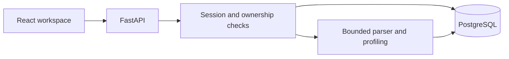

# Architecture

React calls the same-origin `/api` service. FastAPI validates requests and obtains the current session. Dataset queries always include the owner ID. Processing functions receive bytes/rows and limits, not HTTP objects or database sessions.

`users` stores roles, account status and optional guest expiry. `login_sessions` stores only session-token digests. `datasets` stores source bytes, checksum, worksheet, column names and parsed text/null values. Delete/expiry cleanup cascades through ownership. Raw bytes are not exposed by listing or profile responses.

Initial parsing is synchronous and bounded, so there is no pretend background-job queue. Future cleaning must store derived immutable versions and leave source bytes unchanged. A workflow must record its definition and input version rather than read changing live settings halfway through execution.

Rate limiting currently uses bounded per-process buckets. It does not provide a shared multi-replica limit. Backend services should be deployed as one bounded instance until a durable limiter and broader operations checks exist.
