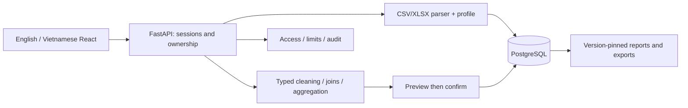

# Architecture

React calls the same-origin `/api` service. FastAPI validates typed requests, authenticates cookie/CSRF state and scopes every dataset/workflow/report query to its owner. Pure processing functions receive rows and limits rather than HTTP objects or database sessions. This is a bounded modular monolith, with one application instance.

`datasets` retains uploaded bytes/checksum and parsed text/null records as version 1. `dataset_versions` contains immutable derived rows; restore changes a pointer. `previews` is temporary and never applies itself. Workflow definitions retain column contracts and typed operations, with separate persisted runs capturing input/definition versions and lifecycle timestamps. The bounded runner executes on request, not a pretend distributed queue. Saved reports retain their source version and configuration and recompute from that immutable input.

Authentication uses Argon2id, random HttpOnly cookie sessions with only digests in storage, CSRF, expiry and revocation. Guest deletion cascades through owned data. Admin operations manage accounts and operational metadata while ordinary ownership rules remain in effect. No request body containing a password, token or uploaded value is logged.

Writes lock the singleton revisioned configuration, then the owner. Cached conservative payload sizes make user/global quota checks cheap and atomic across concurrent writes. Automatic maintenance checks expiry every sixty seconds while awake; CLI/admin cleanup calls the same routine. Per-process/IP request buckets remain deliberately single-instance. They do not substitute for infrastructure-level abuse protection or justify multi-replica deployment.

PostgreSQL is the application database; SQLite is only a fast test adapter. Tests guard `dataflow_test`; browser fixtures separately guard `dataflow_e2e`. Source values remain text until explicitly converted. IDs/finance/dates are never corrected by inferred business guesses. No source history is overwritten by a failed conversion, stale preview or a new workflow definition.
